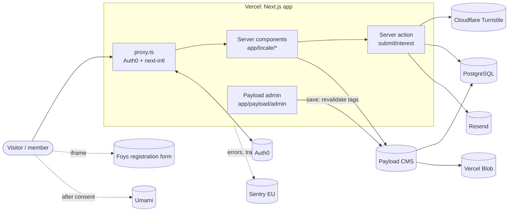

# Architecture

How the usbasketball.nl codebase is put together: what runs where, how a request flows, where data lives, and the rules the code follows. For setup and commands see [README.md](README.md).

## At a glance

A single Next.js 16 App Router application, deployed on Vercel. It is mostly a content site: public pages rendered on the server from translation files, with a handful of features that reach out to other services. There is no separate backend; the only server-side write is the interest form.



| Service | Used for | Code |
|---|---|---|
| Auth0 | Login (Universal Login), session cookies | `lib/auth.ts`, `proxy.ts` |
| Payload CMS | Training schedule, ALV documents and notes, task roster PDF; admin at `/admin` | `payload.config.ts`, `payload/`, `lib/payload.ts` and the four fetchers |
| PostgreSQL | Interest form submissions | `lib/prisma.ts`, `prisma/contract.prisma` |
| Resend | Interest form emails | `lib/email.ts` |
| Cloudflare Turnstile | Bot protection on the interest form | `components/turnstile.tsx`, `lib/actions/interest.ts` |
| Foys | Membership registration form, embedded | `components/foys-registration-form.tsx` |
| Sentry | Errors, traces, logs | `instrumentation*.ts`, `sentry.*.config.ts`, `next.config.ts` |
| Umami | Page analytics, consent-gated | `components/AnalyticsGate.tsx` |

Bestuur is a separate club service ([usbasketball/bestuur](https://github.com/usbasketball/bestuur)). It also generates the signed links for `/register`.

## Layers

```
proxy.ts                 edge of the app: auth routes, session cookies, locale routing
app/                     routes: pages, layout, metadata routes, one API route
components/              UI; server components by default, client components where marked
lib/                     everything that talks to a service or holds shared logic
i18n/ + messages/        locale routing, request config, translation strings
prisma/                  database schema (contract)
```

Dependencies point downward: pages import components and `lib/`; components import `lib/`; `lib/` modules do not import from `app/` or `components/`. `lib/` is where every external call lives, one module per integration, so a page never constructs a client itself.

### Routes (`app/`)

| Route | Group | Notes |
|---|---|---|
| `/`, `/about`, `/committees`, `/confidential-counsellor`, `/faq`, `/learning`, `/membership`, `/privacy` | `(public)` | Static content from `messages/` |
| `/schedule` | `(public)` | Rich text from Payload |
| `/signup` | `(public)` | Interest form |
| `/register` | `(public)` | Foys form, only with a valid signed link |
| `/login` | `(public)` | Gateway to `/auth/login` |
| `/me`, `/tasks`, `/alv` | `(private)` | Require an Auth0 session |
| `/auth/login`, `/auth/logout`, `/auth/callback` | none | No files: handled by the Auth0 middleware in `proxy.ts` |
| `/admin`, `/api/*` | `(payload)` | Payload admin and REST API; own root layout, skipped by `proxy.ts` |
| `/sitemap.xml`, `/robots.txt`, `/llms.txt` | none | Generated metadata routes |

All pages sit under `app/[locale]/`. The route groups `(public)` and `(private)` only organise files; they do not add a URL segment or any behaviour. `app/[locale]/[...rest]/page.tsx` catches unknown paths so the 404 page is localized. `app/[locale]/layout.tsx` is the root layout (there is no `app/layout.tsx`): fonts, header, footer, consent banner, JSON-LD and the analytics gate.

Legacy Dutch URLs from the previous site (`/informatie`, `/aanmeldformulier`, `/takenschema`, `/vertrouwenspersoon`) are permanently redirected in `next.config.ts`.

### Components

Server components unless they need browser state. The client components are the navigation (`left-nav`, `mobile-nav`, `mobile-header`, `active-link`, `locale-switcher`), the interest form and Turnstile widget, the Foys iframe wrapper, the consent banner and analytics gate, and the visual effects (`parallax`, `scroll-reveal`). `components/header.tsx` is a server component that reads the session and passes `isLoggedIn` and the nav items down to the client navigation.

Styling is Tailwind v4 with theme tokens defined in `app/globals.css` (`ink`, `paper`, `line`, `accent`, `brand`; `font-display` is Bebas Neue, `font-sans` is Inter). Shared form class strings are in `lib/field-styles.ts`.

## Request lifecycle

1. **Proxy.** `proxy.ts` matches every path except `/api`, `/sentry-tunnel`, Next internals and paths containing a dot. It runs the Auth0 middleware, returns its response directly for `/auth/*`, and otherwise runs the next-intl middleware and copies the Auth0 response headers (rolling session cookies) onto that response.
2. **Locale.** next-intl redirects un-prefixed paths to a locale (`localePrefix: "always"`, default `nl`). `i18n/request.ts` loads `messages/<locale>.json` and returns a 404 for any other first segment.
3. **Layout.** `app/[locale]/layout.tsx` renders. The header calls `auth0.getSession()`, which reads cookies, so every page is rendered per request rather than prerendered.
4. **Page.** The page's server component fetches what it needs through `lib/` and renders. Private pages check the session first and redirect to `/login` without one.

## Internationalization

- Locales `en` and `nl`, defined once in `i18n/routing.ts`.
- All UI strings live in `messages/en.json` and `messages/nl.json`, namespaced per page or component. Server code uses `getTranslations` / `getFormatter`; client components use `useTranslations`.
- Links and redirects go through `i18n/navigation.ts` so the locale prefix is added automatically. The exception is the Auth0 routes, which are plain `<a>` tags because they must be full-page navigations and have no locale.
- CMS content is single-language. Emails pick their language from the locale submitted with the form.

## Authentication and access

- `lib/auth.ts` exports the `Auth0Client` singleton and `authEnabled()`, which is true only when all four `AUTH0_*` variables are set. Every use of the client is guarded by it, so the app runs without Auth0 configured (`/auth/*` then returns 503).
- Sessions are encrypted cookies managed by the SDK; this app stores no user records.
- Authorization is binary: a page either requires a session or does not. There are no roles. Each private page performs the check itself.
- `/register` uses a different mechanism because its audience has no account yet: an expiring HMAC-signed link (`lib/registration-link.ts`), with the secret shared with bestuur.

## Data and content

### Database

PostgreSQL, accessed through experimental Prisma 8 contracts. `prisma/contract.prisma` is the schema; `prisma contract emit` (run on `npm install`) generates `prisma/contract.json` and `prisma/contract.d.ts`, which are git-ignored. `lib/prisma.ts` builds the typed `db` singleton from them, cached on `globalThis` in development to survive hot reloads. Date and time columns are `Temporal` values, provided by `temporal-polyfill`.

The contract defines `InterestSubmission`, `User`, `ClubMembership`, `CompetitionTeam` and `Match`. This app only uses `InterestSubmission`; the other models are not referenced by any code here.

### Payload CMS

Payload runs inside the same Next.js app: the admin and REST API live in the `app/(payload)/` route group (its own root layout, excluded from `proxy.ts`), the schema in `payload.config.ts` and `payload/`. Its tables sit in the `payload` schema of the same PostgreSQL database, separate from Prisma's `public` tables. Uploads (PDFs) go to Vercel Blob. Editors authenticate through Auth0 (`payload/auth0-strategy.ts`, allowlist in `PAYLOAD_ADMIN_EMAILS`).

Four fetchers share one shape through `cmsRead` in `lib/payload.ts`:

- read one global or collection with the Payload Local API and map it to a small typed object,
- wrap the read in `unstable_cache` with a tag and no expiry,
- return the empty value (`null` or `[]`) when Payload is unconfigured (`payloadEnabled()`) or the read fails, without caching either case,
- tags are defined in `lib/cms-tags.ts`; an `afterChange` hook on the source collection or global revalidates them.

Pages render an empty state for `null`/`[]`. Content refreshes as soon as an editor saves, or on a new deploy.

### Static content

Everything else (page copy, FAQ, fees, committees) is in the message files. Club facts used in metadata and structured data (name, address, emails, social links) are in `lib/site.ts`.

## The interest form

The one write path, and the template for future forms:

- `components/interest-form.tsx` is a client component using `useActionState`. It validates in the browser for fast feedback and attaches the Turnstile token.
- `lib/actions/interest.ts` is the server action. It re-validates everything, verifies Turnstile, inserts the row, then sends the emails without letting an email failure fail the submission.
- The action returns `{ error: "<key>" }` or `{ success: true }`. The key is looked up under `Signup.errors` in the message files, so server errors are translated like any other string.

## SEO and discoverability

- `lib/seo.ts` builds each page's metadata: canonical URL, hreflang alternates (with `nl` as `x-default`), Open Graph and Twitter tags. Private and utility pages pass `robots: noindex`.
- `lib/site.ts` builds JSON-LD (`SportsOrganization`, `WebSite`, a recurring training `Event`, `FAQPage`), rendered through `components/json-ld.tsx`.
- `app/sitemap.ts`, `app/robots.ts` and `app/llms.txt/route.ts` are generated from `siteConfig`. All absolute URLs derive from `NEXT_PUBLIC_SITE_URL`.

## Observability and privacy

- Sentry is initialised for the browser (`instrumentation-client.ts`), Node (`sentry.server.config.ts`) and edge (`sentry.edge.config.ts`), with 10% trace sampling in production and console output forwarded as logs. In the browser, tracing and logs are sent only after analytics consent (`tracesSampler` and `beforeSendLog` check the consent cookie at call time); error events are always sent. Browser events go through the `/sentry-tunnel` route on the site's own domain. Server-side failures in the interest form are tagged `feature: interest_form` or `interest_form_turnstile`.
- Analytics is opt-in. The root layout reads the first-party `usbasketball_consent` cookie on the server (`lib/consent-server.ts`) and seeds `ConsentProvider`, so the banner and the Umami script are correct in the first HTML. `ConsentBanner` writes the cookie, `AnalyticsGate` renders the Umami script only in production and only when `useConsent().has("analytics")`, and the footer's cookie-settings button reopens the banner to change or withdraw consent (withdrawal reloads the page). Categories live in `lib/consent.ts`.

## Configuration

All configuration is environment variables, documented in `.env.example`. Two conventions matter:

- **Unset-safe.** Auth0, Payload, Turnstile and Umami may all be missing; the build and the public pages must still work. New integrations should follow the same pattern (a guard function or a nullable client).
- **Public vs. server.** Only `NEXT_PUBLIC_*` values reach the browser. `lib/site.ts` reads the public ones once and exports them as `siteConfig`.

## Build, test and deploy

- **Deploy:** Vercel's Git integration builds and deploys; outside Vercel `next.config.ts` switches to standalone output. The config is wrapped by the next-intl and Sentry plugins.
- **Unit tests:** Vitest, files named `*.test.ts(x)` next to the code they cover.
- **End-to-end:** Playwright in `e2e/`, mobile viewport, against a production build in CI.
- **CI:** `.github/workflows/e2e.yml` (typecheck, unit, e2e) and `.github/workflows/gitleaks.yml` (secret scanning, also available as a pre-commit hook). Dependabot opens npm updates daily and GitHub Actions updates weekly.

## Conventions

The working rules for contributors and coding agents are in [AGENTS.md](AGENTS.md). The ones that shape the architecture:

- Import with the `@/` alias from the repo root.
- Navigate with `@/i18n/navigation`, never `next/navigation`; write redirects as `return redirect({ href, locale })`.
- Use the `auth0` and `db` singletons; never construct a client in a page or component.
- Put server actions in `lib/actions/` and return translatable error keys.
- Give every CMS fetcher a cache tag (`lib/cms-tags.ts`) and revalidate it from an `afterChange` hook on its collection or global.
